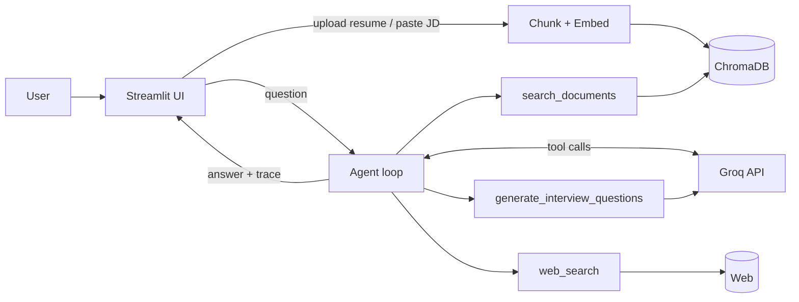

# 🎯 Career Coach — GenAI Capstone

An AI career assistant that analyzes your resume against a job description, finds skill gaps, researches the market, and generates tailored interview questions.

**Live demo:** _add link_ · **Demo video:** _add link_

## GenAI concepts demonstrated

| Concept | Where |
|---|---|
| LLM API | Groq API, Llama 3.3 70B with function calling (`agent.py`, `tools.py`) |
| Prompt engineering | Structured system prompt with process + output format (`agent.py`); role-specific prompt for question generation (`tools.py`) |
| RAG | Resume/JD → chunking → local embeddings → ChromaDB → semantic retrieval (`rag.py`) |
| Tools | `search_documents`, `web_search`, `generate_interview_questions` (`tools.py`) |
| Agents | Tool-use loop where the model decides what to call and when to stop (`agent.py`) |

## Architecture



## Run locally

```bash
python -m venv .venv && source .venv/bin/activate
pip install -r requirements.txt
export GROQ_API_KEY=gsk_...   # Windows PowerShell: $env:GROQ_API_KEY="gsk_..."
streamlit run app.py
```

## Deploy (Streamlit Community Cloud)

1. Push this repo to GitHub.
2. On share.streamlit.io, create an app pointing at `app.py`.
3. Under **Settings → Secrets**, add `GROQ_API_KEY = "gsk_..."`.

## Limitations & next steps
- Vector store is in-memory per session (no persistence).
- Add re-ranking, cover-letter generation, and evaluation of retrieval quality.
